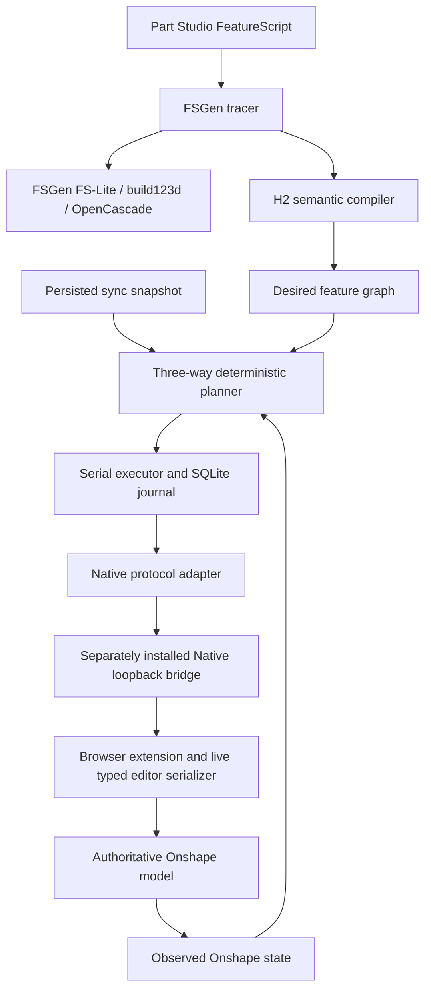

# Capability evidence

This matrix distinguishes upstream implementation evidence from verification of
the integrated system. No live Onshape tests have been performed in this project.

| Capability | FSGen upstream | Onshape Native upstream | Integration acceptance |
|---|---|---|---|
| Script to separate native features | Implemented tracer/serializer | Different typed editor protocol | Pending compiler tests |
| Editable sketches and dimensional constraints | Native feature JSON, not mesh | Captured native sketch commands; creation not replay-verified | Live blocked |
| Native extrusion | Full REST feature serialization | Add/specify/commit observed; specific edit replay noted upstream | Live creation blocked |
| Local geometry | OpenCascade via build123d; partial outcomes possible | No local CAD kernel | Pending retained validation tests |
| Incremental modification | Positional suffix rebuild | Native feature edits and REST patch path | Safe semantic planner pending |
| Three-way human/AI parameter merge | Absent | Absent | Pending deterministic merge tests |
| Atomic revision rejection | REST path can support revision fields | Native path only client preflight | Native existing-document writes blocked |
| Unknown-write handling | Needs audit of retry behavior | Broker never automatically replays | Durable reconciliation pending |
| Native readback | REST full features/geometry | Editor tree; full semantic/regeneration proof not stable | Live verification adapter blocked |
| Topology identity | Query expressions and native IDs | Captured/live native selection IDs | Ambiguous selection must fail closed |
| Authentication | Developer API key in REST mode | Authenticated browser plus private loopback pairing | No credential acquisition attempted |
| Assemblies | Outside initial native Part Studio slice | Several native commands replay-verified upstream | Unsupported in current integration |
| Browser API quota exemption | Not applicable | Native RPC and browser REST are distinct paths | No quota exemption claim |

## Subsystem and dependency map

The bridge dependency is optional and installed as a pinned local fork with
compatibility patches. User-reported owner permission is recorded in
`UPSTREAM-PERMISSION.md`; upstream attribution is retained. Browser REST and
official developer REST are not implicit execution alternatives.

## Required operation inventory and current gaps

Initial native slice requires runtime schema detection, exact tab/target binding,
fresh insertion position and node IDs, plane query resolution, sketch creation,
rectangle entities and constraints/dimensions, extrusion profile resolution,
feature commit, and full semantic/regeneration readback. Captured command shapes
alone do not prove those operations can be compiled correctly for a new session.

Later feature coverage requires variables, circles/holes, fillets/chamfers,
patterns, transforms, boolean operations, face-relative sketches and assemblies.
Each requires dependency and identity-preservation tests before support is claimed.

Fragile native dependencies include webpack module profiles, constructor registry,
typed field/class IDs, editor tree shape, feature-node allocation, selection and
transaction sequence state. Unsupported builds must fail without writes.
